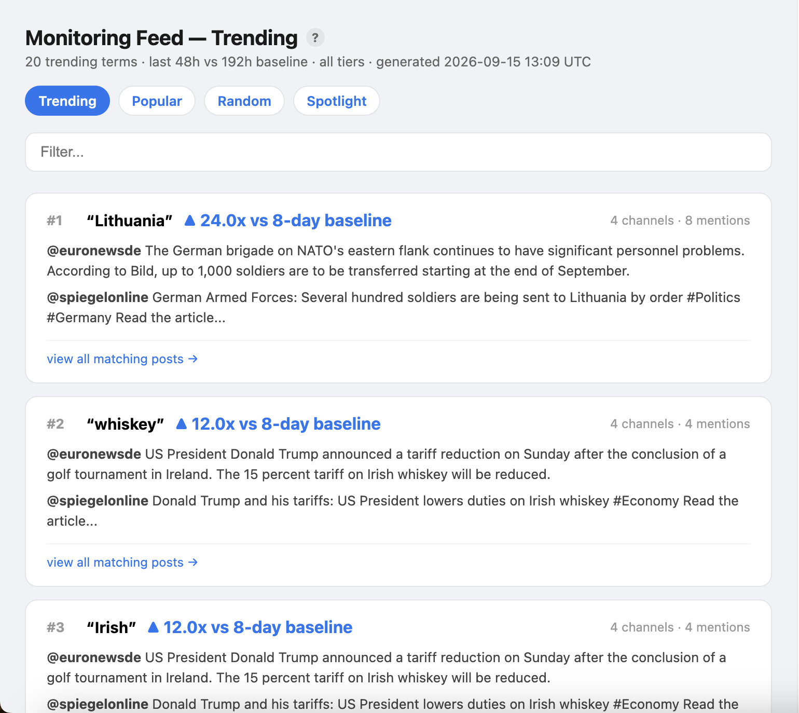
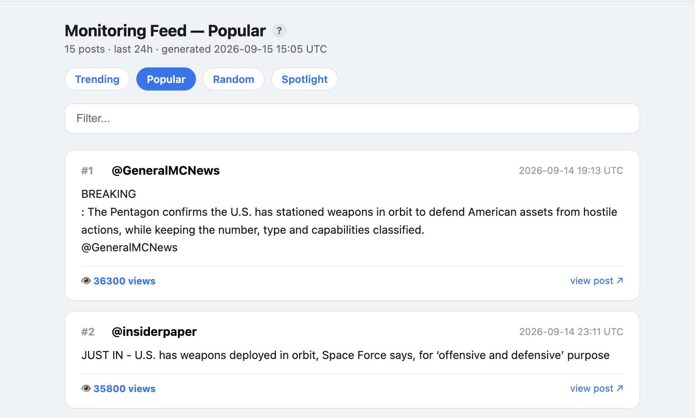
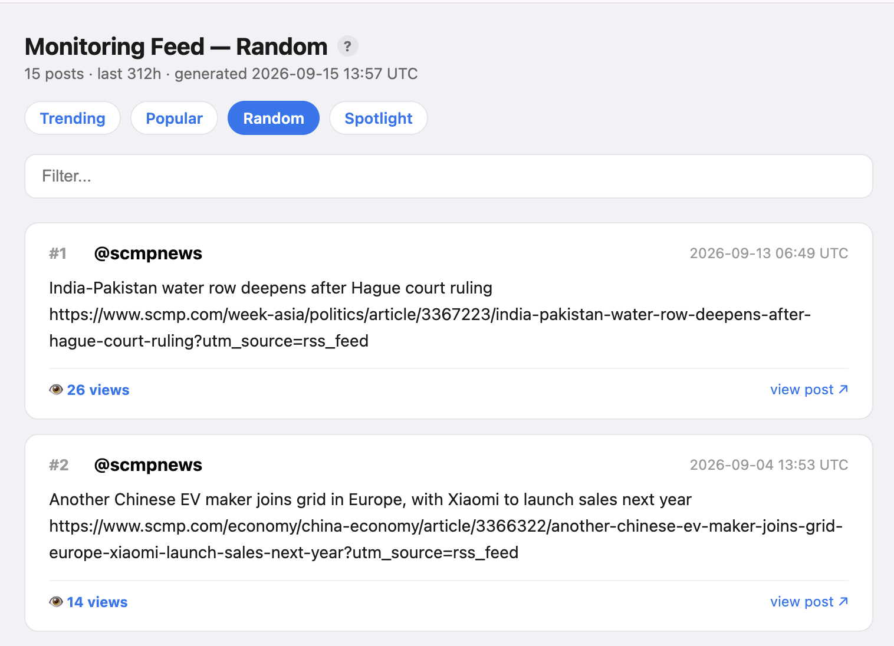
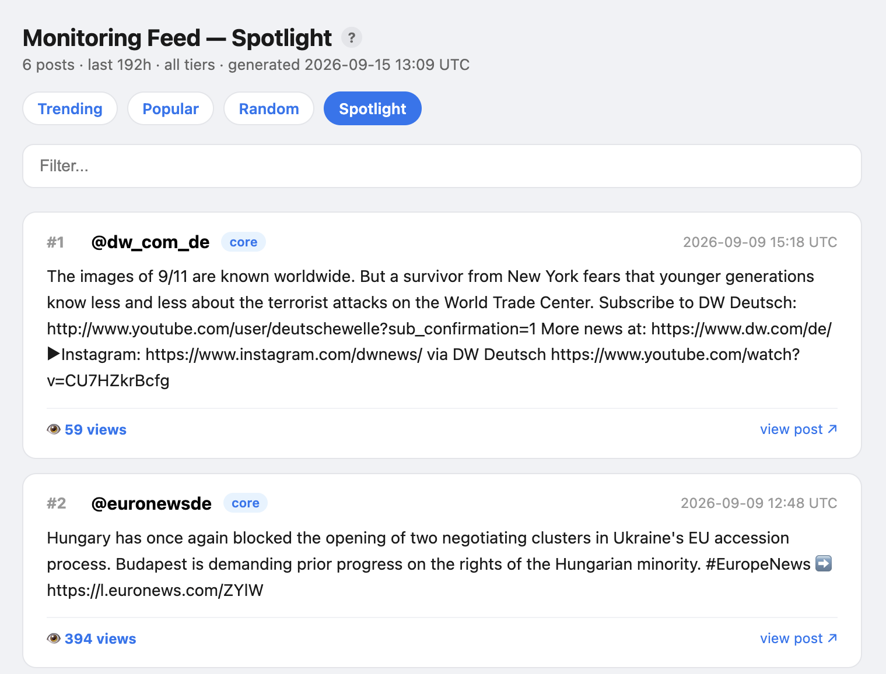

# Telegram Monitoring Feed

Turn a list of Telegram channels into a browsable feed of what's posting,
what's popular, and what's spreading without opening the Telegram app.

**Overview** · [Install](docs/install.md) · [Use](docs/usage.md) · [Getting good results](docs/getting-good-results.md)

## Why this exists

As a disinformation reporter, I'm constantly scanning social media for
viral claims. And yet, time and again, I default to X. I mean yes,
there's a lot of disinformation on X, but that's not why. It's because
(for all its faults) X presents a clean, readable, scrollable feed of
posts. For me, that makes it incredibly easy to monitor.

Enter Telegram. No main feed, just channels. To monitor, you have to know
what channels you're looking at, go into each one individually, read
that channel's feed, exit, and repeat. It's maddening and not a useful
way to monitor.

Instead, I wanted to be able to scroll a searchable, X-like feed of
Telegram posts and quickly see which posts are most popular and which
topics are trending.

This tool is especially nice because you don't even need a Telegram
account, let alone API access or developer credentials. If you give it
the channel names, the tool will scrape directly from that channel's
public webpage (`t.me/s/channelname`) and read what's posted there.
Everything is saved locally to your machine, which makes archival easier
and keeps your data secure.

But, crucially: this tool is only as effective as the channels you give
it to look at. So spend some time developing a good list of channels
you'd like to monitor — more tips on how to do that in
[Getting good results](docs/getting-good-results.md#finding-channels-to-monitor).

Happy monitoring!

## What it does, in plain terms

- **Scrape** — visits every channel in your list and saves what they've
  posted recently into a small local database on your own computer.
  Nothing is uploaded anywhere.
- **Feed** — turns what's scraped into four browsable web pages (see
  [The four feed pages](#the-four-feed-pages) below).
- **Search** — full-text search across everything you've ever scraped, by
  keyword and date range, showing chronologically how something spread.
- **Audit** — flags channels in your list that never produced a single
  post, usually a sign the handle is wrong or the channel's gone private.

### The four feed pages

**Trending** — words or phrases spreading across several channels
right now, more than they normally do. This is the one most likely to
catch something before it's an obviously "popular" post.

**Popular** — the most-viewed posts right now. If the same post got
copy-pasted across five channels, it's shown once with a badge saying
so, instead of cluttering the page five times.

**Random** — a random sample, so you're not only ever seeing whatever
the popularity ranking surfaces.

**Spotlight** — each channel's own best post, so a quiet channel's
one interesting post of the day shows up next to a busy channel's
best post, instead of getting buried underneath it.

## Get started

1. **[Install](docs/install.md)** — download the tool and set it up (one time only).
2. **[Use](docs/usage.md)** — scrape your channels, browse the feed, search, and clean up.
3. **[Getting good results](docs/getting-good-results.md)** — finding channels, filtering out spam and filler words, scraping etiquette, and limitations.

## License

MIT — see [LICENSE](LICENSE).

Disclaimer: built with AI assistance (Claude Sonnet 5), reviewed and tested by me.

## About

Written by [Josh Axelrod](https://josh-axelrod.com), an investigative
reporter and 2023–24 Fulbright Journalism Fellow based in Berlin,
Germany. He covers extremism, disinformation, and technology; his work
has appeared in WIRED, Mother Jones, Deutsche Welle, Die Zeit, The Daily
Beast, NPR, and more.
